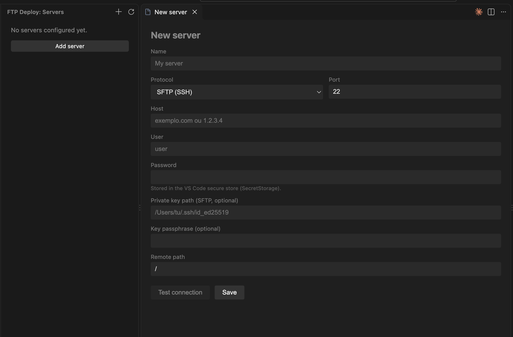
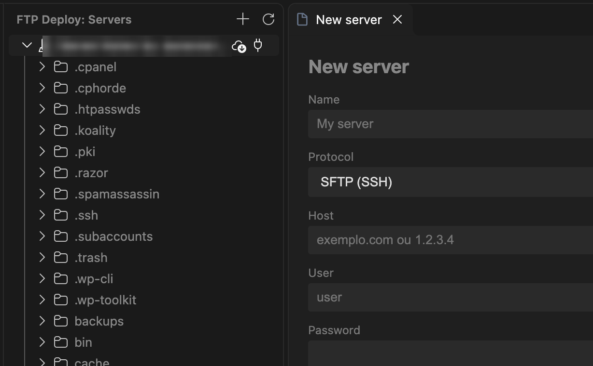

# FTP Deploy Connector


A VS Code extension for SFTP/FTP deployment: configure servers in a visual
panel, browse remote files in a sidebar tree, and download or upload files.

## Screenshots

### Configuration panel



### Remote file tree



## Features

- **Visual configuration panel** with a **Test connection** button — no JSON
  files to edit by hand.
- **Settings page** to manage multiple servers and toggle auto-upload.
- **Remote file tree** in the sidebar: browse folders and open server files.
- **Right-click upload** on any file or folder in the Explorer. With several
  servers configured, it asks which one — just like PhpStorm.
- **Auto-upload on save** (on by default). With several servers it asks which
  one, once per file per session.
- **Download** files and folders (remote to local).
- Supports **SFTP** (with private key and passphrase) and **FTP**.
- Passwords and passphrases are stored in the VS Code **encrypted
  SecretStorage** — never in plain text.

## Installation

### Option A — `.vsix` file

1. Download the latest `.vsix` from the
   [Releases](https://github.com/nogueira002/vscode-ftp-deploy/releases) page
   (or build it with Option B).
2. Install it in one of two ways:
   - **UI:** `Cmd/Ctrl+Shift+X` -> `...` menu (top right) ->
     **Install from VSIX...** -> pick the file.
   - **Terminal:**
     ```bash
     code --install-extension ftp-deploy-connector-0.2.0.vsix
     ```
3. Reload the window (`Developer: Reload Window`). The **FTP Deploy** icon
   appears in the activity bar.

To build your own `.vsix` from source:

```bash
npm install
npx @vscode/vsce package
```

### Option B — from source (development)

```bash
git clone https://github.com/nogueira002/vscode-ftp-deploy.git
cd vscode-ftp-deploy
npm install
npm run compile
```

Open the folder in VS Code and press **F5**. A second window
(*Extension Development Host*) opens with the extension loaded.

## Usage

1. Open your project folder (the download destination).
2. Click the **FTP Deploy** icon in the activity bar (left).
3. Click **+** (Add server) -> fill in the form -> **Test connection** ->
   **Save**. Add as many servers as you need.
4. Expand a server in the tree to browse the remote side. Right-click a remote
   file or folder -> **Download**.
5. To upload, right-click a local file or folder in the Explorer ->
   **FTP Deploy: Upload to server**. With several servers, pick which one.
6. With **auto-upload on save** enabled (the gear -> Settings), saving a file
   uploads it automatically.

## Commands

| Command | Action |
|---|---|
| `FTP Deploy: Add server` | Open the configuration panel |
| `FTP Deploy: Settings` | Open the settings page |
| `FTP Deploy: Test connection` | Connect and list the remote folder |
| `FTP Deploy: Upload to server` | Upload the selected file or folder |
| `FTP Deploy: Download (remote -> local)` | Download a file or folder |
| `FTP Deploy: Refresh` | Reload the tree |

## Security

- Passwords and passphrases are kept in the VS Code **SecretStorage**,
  encrypted by the operating system.
- The rest of the configuration (host, user, port, paths) is kept in the
  extension's `globalState`.
- No secret is written to `package.json` or to project files.

## Contributing

Contributions are welcome. See [CONTRIBUTING.md](CONTRIBUTING.md).

## License

[MIT](LICENSE) (c) 2026 Ricardo Nogueira
